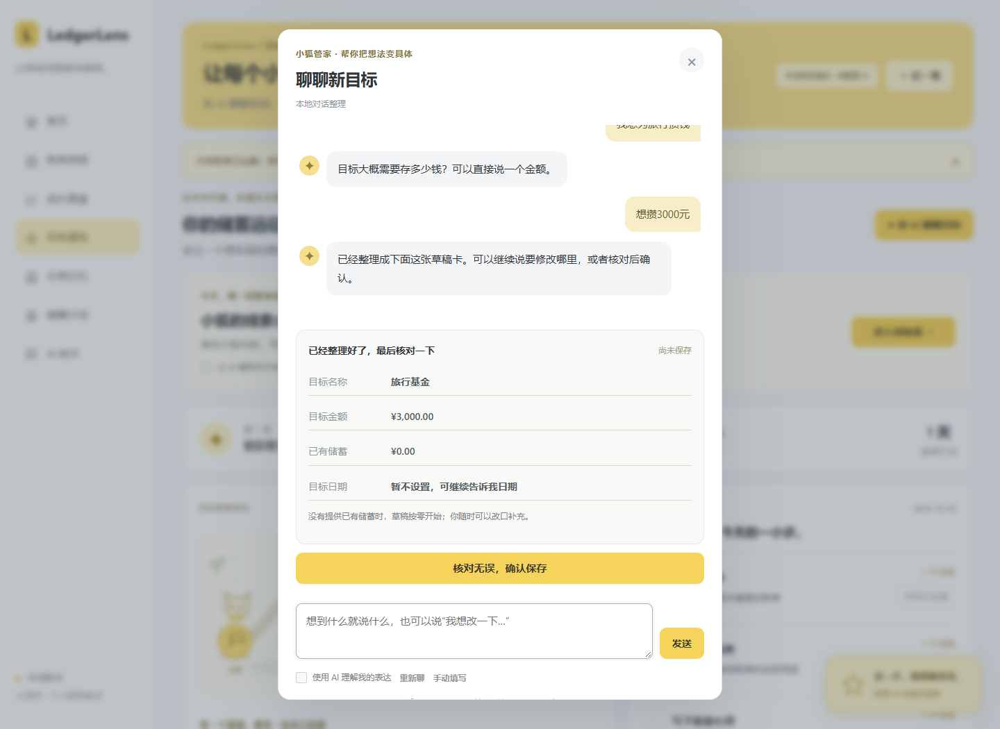
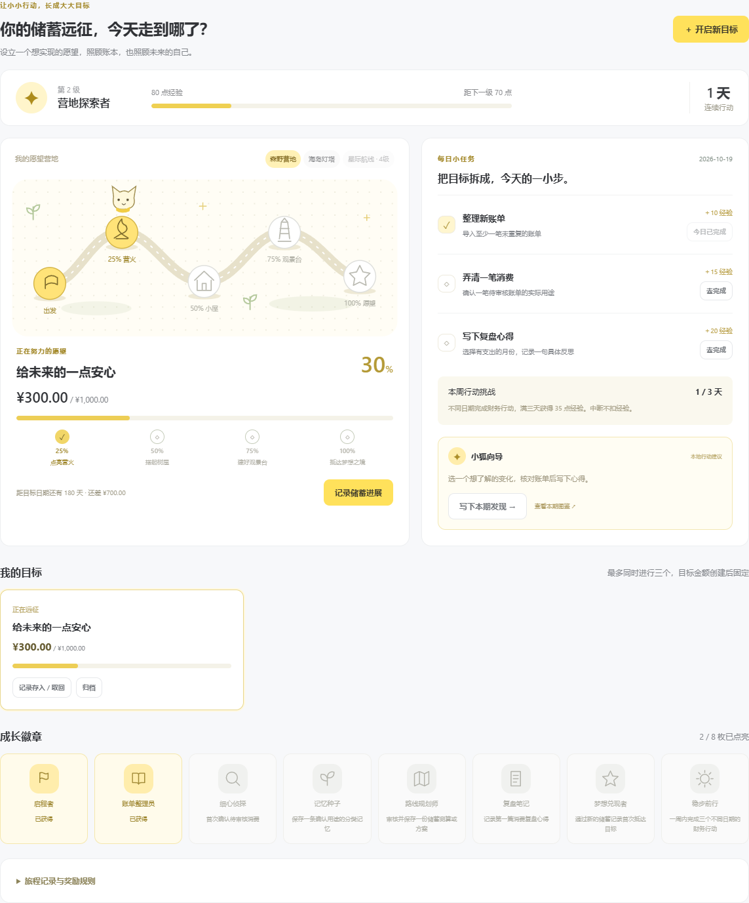
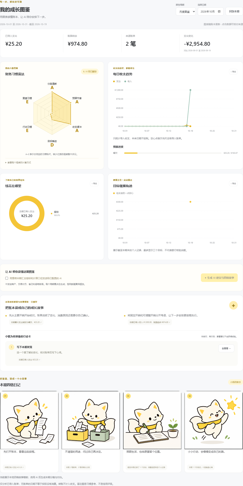

# LedgerLens — AI Personal Finance Assistant

A runnable CSSE2026 project with a browser, standard-library Python backend and SQLite. The prototype includes confirmed purpose memory, financial conversations, constrained savings alternatives and monthly reviews. The 19 October update adds a goal adventure with persistent allocations, milestones, earned experience, badges and unlockable scenery. The implementation and materials were produced with substantial OpenAI Codex assistance. Actual Budget and Firefly III are related work; their source code was not incorporated.

The software interface defaults to Simplified Chinese, including categories, validation, provenance, conversations, templates and exports. Original user text and internal identifiers remain intact. Chinese and English CSV headers/kinds/categories are accepted.

## 现在从对话开始

打开后通过侧栏或手机导航进入 **首页、账单、图表、冒险、记忆、储蓄、AI 助手**，每个视图独立显示。

所有业务录入默认使用小狐管家的 **对话 → 草稿 → 确认**：记一笔、设立目标、预算、储蓄方案、存入或取回、复盘、分类用途与记忆。直接说“我想攒钱旅行”，AI 会问必要细节；不必先填完表格。原表单可从“手动填写”打开。

冒险页新增可玩的 **小狐线索小岛**：点选或按数字键找用途线索，答对后点击前进或按方向键移动角色。AI 编写探险引子，程序核验答案和每日奖励。见 [本轮设计与验证](docs/UPDATE_2026-10-20.md)。



## Run

Requires Python 3.11+ and a modern browser. The application needs no third-party packages.

```powershell
python app.py
```

Open http://127.0.0.1:8765, or double-click `Start_LedgerLens.bat`. Click **加载示例账单** for 30 synthetic records. Imports append and skip duplicates without replacing existing records. Data persists in `data/ledger.sqlite`. For an independent workspace run `python app.py --port 8768 --db data/new-demo.sqlite`.

## 成长图鉴、AI 向导与快速记账

本轮界面参考用户提供的记账软件截图，采用黄色强调色、白色卡片、细线图标和手机底部导航，保留 LedgerLens 的独立名称与功能。

- **记一笔**：分类网格与表单；一句话生成可编辑草稿，核对后保存。金额和日期由程序提取；可选 AI 理解用途；重复提交跳过。手动确认的分类优先于自动记忆。
- **成长图鉴**：周报／月报、每日收支折线图、分类环形图、目标累计储蓄轨迹、预算进度和六维雷达图。点击数据或来源标签可核对账单，图表可导出为 SVG。
- **AI 小狐向导**：理解本期汇总指标，给出带事实引用的建议、可前往现有功能的行动卡，以及连续四格分镜和对白。向导也出现在游戏任务面板。
- **明确的数据边界**：缺少记录的维度暂不评分；当前周期按相同已过天数比较；转账不计收支。六维图是本项目定义的习惯标尺，不是个人信用评分。目标来自用户记录，非银行核验。

打开软件和更改周期会自动整理本地报告。AI 报告需要勾选同意并点击生成，只发送汇总事实与指标，不发送逐笔商户、交易对方和备注。同一份数据的 AI 报告持久缓存，重新打开可直接查看；账本变动后需重新生成。应用关闭时不会在后台定时调用模型。

四格插画是项目预制的简约卡通素材；**本期分镜与对白由运行时 AI 生成**，并非每次重新绘制图片。服务失败或引用无效时清楚显示本地模板。详见 [报告与 AI 设计](docs/AI_REPORTS_DESIGN.md)。





## GitHub 协作

公开仓库：https://github.com/TianyuUniverse/LedgerLens 。真实分支、PR、CI 和贡献填写方式见 [CONTRIBUTING.md](CONTRIBUTING.md)。首次提交导入已有原型，后续提交记录实际改动；没有模拟三位成员的提交或审核。私有配置、账本、临时文件和历史提交材料不上传。

## Goal adventure / 目标冒险

Click **和 AI 聊聊目标** to describe a wish. The assistant asks for necessary details and shows a draft before confirmation; the original amount/date form is available as an optional manual fallback. Use **记录储蓄进展** for money you confirm has been set aside, or record a withdrawal when plans change. The camp develops at 25%, 50%, 75% and 100%. Progress survives reloads and archiving; up to three goals can be active.

These are self-reported earmarked savings, not verified bank balances or forecasted income. They do not create or change ledger transactions. Starting savings set the journey position without milestone XP. Subsequent entries use exact fen arithmetic and operation IDs to make retries idempotent.

Daily quests reward importing new records, confirming an unclear purpose, and recording a reflection on a month with actual expense data. Confirmed memory and saved savings plans unlock badges. Three different action days in a Monday-based week award a weekly bonus. Experience unlocks the forest camp, ocean lighthouse and space route. Missing a day or withdrawing savings does not remove earned XP. Reimporting duplicates, reloading, editing the same day's reflection and crossing a previously reached milestone again do not award duplicate XP. Total milestone XP is capped at 200 per Shanghai calendar day across goals.

The module is `ledger/adventure.py`; its read-only state is part of `/api/state`. Goal/entry/reflection/archive/theme mutations use existing session/origin protection. Reward events are created by server audit hooks within the confirmed ledger transaction, not by a client-supplied claim or LLM tool. `docs/GAMEPLAY_DESIGN.md` explains the rules and demonstration. Motivation benefits are a design hypothesis, not a measured user-study result.

## 分类记忆

1. In **分类记忆**, load **step 1**. These examples are synthetic.
2. Confirm the school meal payment as Expense / Food. Enter its actual purpose and approve automatic reuse of the counterparty and purpose conditions.
3. Confirm the roommate electricity/air-conditioning payment as Expense / Utilities and approve its conditions.
4. Load **step 2**. Matching meal and utility payments are corrected automatically. Tuition to the same school and an unrelated roommate payment return for review.
5. Inspect, edit, disable or delete memories. Existing transactions retain their historical labels and memory version.

The system retains original source labels, counterparty and note, alongside corrected financial kind/category, source memory ID/version and decision reason. Automatic matching requires all user-approved conditions: normalized exact counterparty and/or substring purpose phrases. A payee alone cannot authorize automatic reuse. Semantic model suggestions require review. This retrieves personal examples; it does not train the model. Ordinary quick category edits do not create memory.

CSV headers are `date,description,amount,kind,category`. Category is optional. Optional context headers are `counterparty,note,source_kind,source_category`. Use YYYY-MM-DD, positive CNY amounts with at most two decimals, and canonical kind `income`, `expense` or `transfer`. Preserve payment-channel labels in the source fields. Own-account transfers do not count as spending. Identity includes date, description, amount, original kind, counterparty and note. Reimporting after a correction still detects the original row. Native WeChat/Alipay export adapters are not implemented.

## Conversations, plans and review

In **财务助手**, try `九月为什么比八月花得多？`, then exclude a specific source record with `去掉 #26` (substitute an existing expense ID). Exclusions affect the analysis, never delete transactions. If a description matches several purchases, choose a displayed ID. `取消排除` restores the comparison. Years must be explicit when imported records span several years.

Try `我想六个月存6000，房租不能减，娱乐每月至少留200。`, then `我不想减少餐饮。`. Review the category budgets using **查看预算并选择方案**. Select **选择并保存此方案** to save. The goal, horizon, fixed categories and minimum budgets persist across follow-ups. **新建对话** starts fresh context; existing conversation state remains in the local database.

The **储蓄方案** form also works without a model. It generates three styles using the last three calendar-month means and explicit maximum reduction assumptions. Hard locks and minimum budgets are checked. An impossible goal retains its gap. A changed ledger revision invalidates a saved preview. The three styles may converge when all available reductions are needed. The earlier manual percentage scenario remains separate: on the original 30-record dataset its six-month projection is RMB 6,240 and its four-month projection is RMB 4,160.

**消费复盘** shows monthly category changes, repeated counterparties/descriptions and payments of RMB 20 or less, with source records. A repeated payment does not prove an unwanted subscription. Spending changes do not prove personal motivation.

## Optional DeepSeek integration

Chat uses local deterministic parsing unless **本次对话启用 AI 分析** is checked. Model mode understands requests and chooses read-only tools. Python validates arguments, computes money in integer fen and renders explanations from actual results. Unverified model amounts, citations and unsupported display hints are discarded. There are no SQL or write tools. Calls are limited to three response rounds and four tool executions per question. Errors trigger a visibly labeled local fallback.

Create the private, ignored file `data/provider.json`:

```json
{"api_key":"your-own-key","model":"deepseek-flash","endpoint":"https://api.deepseek.com/chat/completions"}
```

The server loads it only at startup. The file is excluded from Git and the project ZIP. Environment variables `FINANCE_AI_KEY`, `FINANCE_AI_MODEL` and `FINANCE_AI_URL` override the file. `FINANCE_AI_DISABLE=1` forces local mode. The key never reaches browser state.

When opted in, chat can send your question, recent conversation and requested record/tool results, including descriptions and amounts. Clicking **获取分类建议** sends that selected record's description, counterparty, note, original labels and related confirmed memories to the configured provider. It proposes kind/category and never writes until reviewed. Confidence is self-reported, not calibrated. Demonstrate with synthetic records.

The tool allowlist is `query_transactions`, `compare_periods`, `generate_savings_plans`, `monthly_review` and `retrieve_category_memories`. Category-budget calculation and constraint checking are internal to the savings tool.

## Verification

```powershell
python scripts/verify.py
```

This runs **150 domain/HTTP tests** on temporary databases without external model calls or changes to your ledger. The record is `output/evidence/verification.json`; the original 28-test evidence is preserved under `output/evidence/baseline-20261009/`. The legacy rules benchmark remains 18/20 on an authored, rules-informed synthetic convenience sample; baseline grounded Q&A remains 9/9. These figures are not representative accuracy.

Optional Edge/Playwright browser replays:

```powershell
node scripts/browser_check.cjs
node scripts/workflow_browser_check.cjs
node scripts/adventure_browser_check.cjs
node scripts/reports_browser_check.cjs
node scripts/setup_browser_check.cjs
```

These use temporary databases, disable external calls, and check original, AI workflow and goal-adventure interactions plus 390px mobile overflow. Install Playwright and Microsoft Edge first; set `FINANCE_PYTHON` if an explicit Python executable is needed. The original browser script's `--record` option records the baseline demo.

```powershell
python scripts/live_model_check.py
```

This explicitly consumes provider API usage on a temporary synthetic ledger. The recorded run passed three conversational tool-calling checks and three contextual classification checks, with no ledger changes. It is an integration smoke check used during development, not an independent accuracy evaluation. See `output/evidence/live_model_smoke.json`.

## Structure and limitations

| Path | Responsibility |
| --- | --- |
| `ledger/setup_chat.py`, `static/setup-chat.js` | Revisioned conversation drafts and explicit confirmation for seven input flows |
| `ledger/trials.py`, `static/trials.js` | Playable daily synthetic cases, AI story introductions and server-checked rewards |
| `static/pages.js`, `static/comfort.css` | Seven views, readable typography and restrained interaction |
| `app.py` | Loopback HTTP, session token, same-origin boundary and routes |
| `ledger/service.py` | Schema migration, imports, edits, overview, budgets, manual scenarios and audit |
| `ledger/domain.py`, `ledger/memory.py` | Exact-money validation and approved purpose memory |
| `ledger/adventure.py`, `static/adventure.*` | Goal allocations, server-earned rewards, journey scenes and badges |
| `ledger/analytics.py`, `ledger/assistant.py` | Financial tools, constraint checks and persisted conversation context |
| `ledger/provider.py` | Private configuration, HTTPS transport and context-based classification |
| `static/`, `samples/`, `tests/` | UI, synthetic cases and automated checks |
| `docs/`, `output/` | Design, use guide, deliverables and measured evidence |

Single-user loopback teaching prototype; no bank integration, OCR, native payment export adapter, multi-currency support or signed refunds. Planning repeats historical means; missing months count as zero and incomplete months are not extrapolated. Generated plans round each income/category mean separately to fen; default reduction caps are design assumptions. The original manual scenario rounds reductions per category. Audit history is traceable but not tamper-proof. No real-user study or independent held-out model comparison has been completed.

## Delivery materials

The updated source package is `output/LedgerLens_Final_Project.zip`. Read `docs/使用说明.md`, `docs/CODE_UPDATE_2026-10-15.md` and `docs/SUBMISSION_CHECKLIST.md`. The private key and user databases are excluded. Team members are 陈天宇 (202464870547), 朱俊丞 (202464871352) and 张瀚文 (202464871290). Chen is the proposed lead/main developer; actual human work and review still need evidence in `docs/CONTRIBUTIONS.md`.

The polished ten-slide proposal remains `output/精美版/202464870547-陈天宇-202464871352-朱俊丞-202464871290-张瀚文.pdf` and its editable PPTX. Its simple English script is `docs/PROPOSAL_SPEAKING_NOTES_EN.md`, with a printable version at `output/pdf/PROPOSAL_SPEAKING_NOTES_EN.pdf`. Earlier decks, the Chinese script, final-slide draft, report and baseline video remain available. These historical materials keep their original stage statements; this coding update does not regenerate slides, report PDFs or video. Review and update final-defense materials after accepting the implementation.

Related work: [Actual Budget](https://github.com/actualbudget/actual), [Firefly III](https://github.com/firefly-iii/firefly-iii). Protocol: [DeepSeek tool calls](https://api-docs.deepseek.com/guides/tool_calls/), [OpenAI function calling](https://developers.openai.com/api/docs/guides/function-calling). Memory approval, calculations and confirmation policies are project code.
