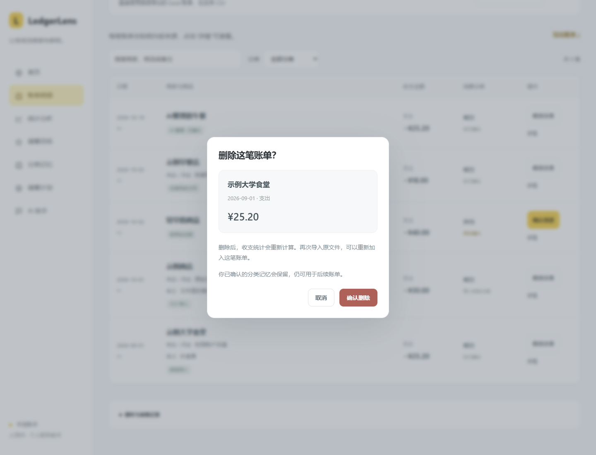

# 账单内容从哪里来

2026-10-20 更新：账单明细去掉编号式章节标题和口号，主列表仅显示日期、商家与商品、收支金额、分类、操作。手机使用卡片；支持搜索和每页 50 笔。

“商品 / 用途”与“消费分类”是两类信息。分类修改不会自动重写原始商品文字。

| 内容来源标签 | 含义 |
| --- | --- |
| 微信导入 | 微信导出文件中的商品或交易内容 |
| CSV 导入 | 导入文件的交易描述列 |
| 你填写的文字 | 用户在表单填写或手动修改的文字 |
| AI 整理 · 已确认 | AI 根据记账对话整理的用途，经用户确认后保存 |
| 记账对话 · 已确认 | 本地程序从用户输入中提取的用途，经用户确认后保存 |
| 记账时已确认 / 较早的记录 | 历史记录没有保存完整整理方式，详情明确说明无法判断是否由 AI 整理 |

“你已确认”“规则识别”“按已记住的规则分类”说明的是分类依据，不是商品文字的来源。原始类型、原始分类、交易单号、记忆版本和手动分类入口移入“详情 → 更多”。示例加载按钮移入导入栏的“其他”，不自动载入示例。

事务入库时记录 `ingestion_origin` 和 `description_origin`。AI 记账草稿在服务端保存草稿编号及原文；确认时比对草稿，用户改写后的文字标为用户修改。对话记账保留文字来源，单独修改金额不会把先前的 AI 整理误记为本地整理。分类修改保留原有内容来源。旧记录未记录的来源不补造。

清理示例前使用 SQLite 备份，并按系统示例的原始指纹核对。非示例内容、个人目标和其他记录保留。清理相关的派生报告缓存和已失效的用途草稿。交易编号使用单独的递增序列，清理后不会把旧账单编号分配给新账单，避免历史引用指错账单。私人清理脚本、备份和用户数据不放入公开仓库。

删除入口：**账单明细 → 详情 → 删除这笔账单 → 确认删除**。确认框列出名称、日期和金额，默认聚焦“取消”；按 Esc 也只返回详情。删除后收支、预算使用额和图表随账本刷新。导入的账单可通过重新导入原文件恢复；对话记账可重新记一笔。

服务端需要账单编号和最新版本，一次事务完成删除、派生缓存清理、用途草稿失效和操作记录。确认期间账单被修改时，要求重新核对。其他账单、预算额度、储蓄目标及已确认的分类记忆保留。来源账单删除后，记忆页明确标注，仍能基于已批准的参考内容编辑规则。删除不会复用旧编号。

验证：186 项 Python 测试通过。新增测试覆盖准确删除与金额变化、过期版本、错误参数、重复请求、空账本、草稿与缓存失效、分类记忆保留及编辑、失败回滚和同源会话保护。六组浏览器检查包含 `scripts/records_browser_check.cjs`，检查来源标签、搜索、手机卡片、删除前取消、Esc、版本冲突、金额更新、刷新后的持久性、分类记忆编辑和最后一笔删除后的空状态。公开截图与测试账本均为合成数据。
