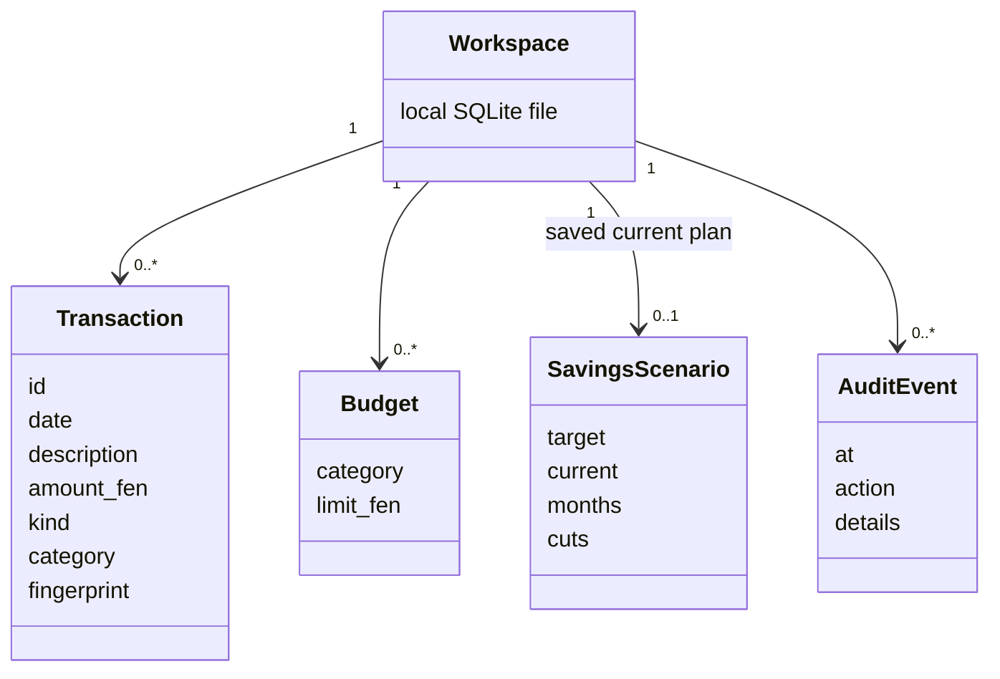
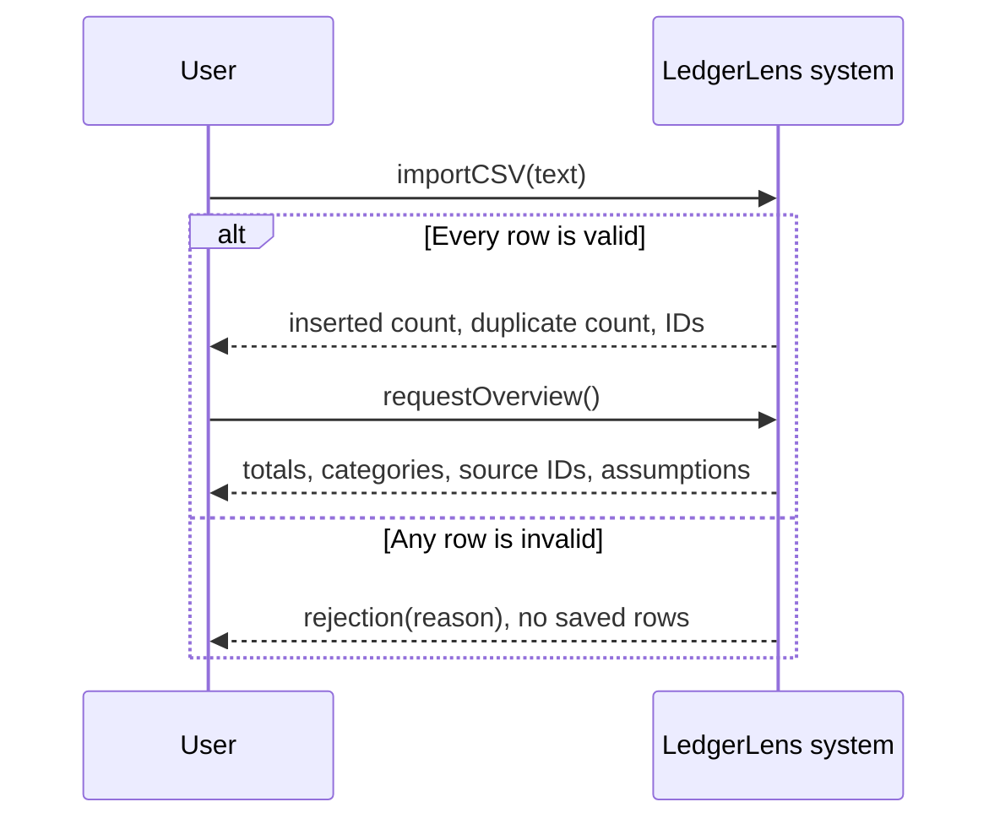
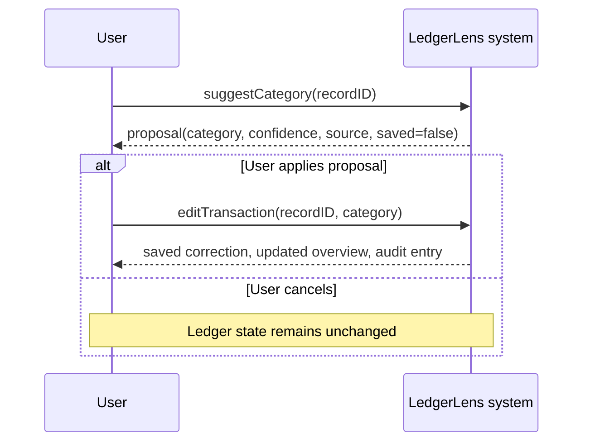

# Requirements, domain and system sequence

## Traceability matrix

| ID | Requirement | Main implementation | Evidence |
| --- | --- | --- | --- |
| R1 | Validate complete CSV and reject invalid batches without partial state | Ledger.import_csv | test_atomic_rejection, test_rollback_on_audit_failure |
| R2 | Prevent repeated record identity and concurrent duplicate counting | unique transaction fingerprint | test_import_counts_and_repeat_duplicates, test_concurrent_duplicate_import |
| R3 | Show exact income/spending with transfers excluded | Ledger.overview | test_overview_exact_and_transfer_excluded |
| R4 | Allow category corrections and preserve audit | Ledger.edit, category dropdown | test_edit_category_recalculates_and_audits, browser replay |
| R5 | Compare goal, horizon and budget reductions | Ledger.plan | test_plan_expected_independent_arithmetic, test_change_horizon_creates_gap |
| R6 | Link analysis and answers to source records | record_ids in overview, plan and answers | test_answer_sources_sum_to_claim, browser category trace |
| R7 | Monitor recurring user budgets | Ledger.set_budget, state budget alerts | test_budget_overrun_source_ids |
| R8 | Keep AI proposals under human control | Ledger.suggest, review dialog and explicit PATCH | test_model_proposal_never_writes, browser cancel/review |
| R9 | Recover from invalid model output and timeout | injected provider seam and rules fallback | test_model_bad_output_fallback, test_model_timeout_fallback |
| R10 | Handle unsupported questions clearly | constrained deterministic answer tools | test_unsupported_and_injection_rejected |

## Domain model

The Workspace denotes the local data boundary, not a separate user/authentication table. Source associations for calculations are computed record IDs rather than persisted scenario-to-transaction join rows.

## System sequence: import and analyze

## System sequence: supervised category suggestion

## Decision log

ADR-001: Use a Python standard-library HTTP server and vanilla JavaScript for local setup simplicity. A framework would help a larger deployed system. Current scope is loopback and single user.

ADR-002: Use integer fen and Decimal parsing instead of floats. Round each average/category reduction explicitly. Exact-money tests use expected values derived independently from the sample fixture.

ADR-003: Put all batch writes and audit in a SQLite transaction and use a unique fingerprint. Browser-only storage would weaken rollback/persistence demonstration. Identical genuine purchases need a distinguishing description.

ADR-004: Treat model output as an untrusted category proposal. Keep money outside the model and preserve human confirmation. A valid schema is a necessary check but cannot establish category correctness.

ADR-005: Use tool-based deterministic answers for a narrow query set. Free-form generation would increase unsupported numerical claims and evaluation burden. Language coverage is intentionally limited and disclosed.
